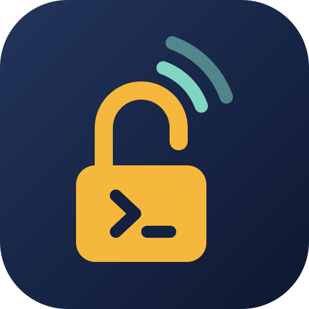

<p align="center"></p>

# LUKS Remote Unlocker

Unlocks LUKS-encrypted Linux servers that wait at the Dropbear pre-boot prompt, from Android, Linux desktop or the command line. One tap per server, or all of them at once.

## What it does

For each server the app:

1. waits until the pre-boot SSH port answers,
2. checks the server's pinned host key and stops if it changed,
3. logs in with the SSH key assigned to that server,
4. hands the disk passphrase to `cryptroot-unlock` and reads the result from its exit code,
5. confirms the boot: the unlock counts as done only when the booted system answers with a different SSH host key than the pre-boot one.

Servers, SSH keys and passphrases are managed in the app. Runs are kept in a history with sanitized logs, and the configuration can be exported and imported.

## Platforms

| Platform | Status |
| --- | --- |
| Android (7.0 and later) | Works; a run continues with the screen off |
| Linux desktop | Works |
| Command line (`luks-unlock`) | Works; see [packages/unlock_cli/README.md](packages/unlock_cli/README.md) |
| iOS | Not finished and not yet tested on a device |

Servers: Debian and Ubuntu with `dropbear-initramfs`.

## Server setup

The server needs Dropbear in its initramfs, started with `cryptroot-unlock` as the forced command. [docs/server-setup.md](docs/server-setup.md) has the four steps.

## Install

There are no published releases yet; build from source. Docker is the only requirement:

```sh
make apk-release   # signed Android APK, needs app/android/key.properties
make apk           # debug Android APK
make linux         # Linux desktop build
make cli           # build/luks-unlock
```

## Security model

The passphrase is only as safe as the server it is sent to, so host-key pinning matters as much as the vault.

- **Vault.** Every private key and passphrase is encrypted with XChaCha20-Poly1305 under one random vault key. On phones that key is released by a fingerprint or face through the device's secure hardware; a recovery password (Argon2id) is the second way in, and the only one on Linux.
- **Host-key pinning.** The pre-boot host key is confirmed on first connect or pasted in advance. A changed key stops that host before login, and there is no "accept anyway" during a run.
- **No retries of a rejected passphrase.** Debian allows three tries by default, so the app never spends them on its own.
- **Nothing leaves the device.** Android backups and device transfer are switched off, screenshots are blocked, only public keys can be copied or shared, and passphrases are stripped from logs.
- **No accounts, no telemetry.** The app talks only to the servers you configure.

Details are in [docs/design.md](docs/design.md#security-model). To report a vulnerability, see [SECURITY.md](SECURITY.md).

## Development

Everything runs in Docker (`tool/Dockerfile.dart`, `tool/Dockerfile.flutter`, `tool/Dockerfile.emulator`); nothing is installed on the host.

| Target | What it does |
| --- | --- |
| `make test` | Analysis and tests for `unlock_core`, `unlock_cli` and the app |
| `make test-core` / `test-cli` / `test-app` | Same for one package; `ARGS="test/x_test.dart"` narrows the run |
| `make cli` | Builds `build/luks-unlock` |
| `make apk` | Debug Android APK |
| `make apk-release` | Signed release APK; needs `app/android/key.properties` |
| `make aab` | Signed release app bundle for the Play Store; needs `app/android/key.properties` |
| `make linux` | Debug Linux desktop build |
| `make shell-dart` / `shell-flutter` | Interactive shell in the toolchain container |
| `make run-dart CMD="..."` / `run-flutter CMD="..."` | One command in the toolchain container |
| `make bench-up` / `bench-down` | Start or remove the Dropbear test bench |
| `make test-bench` | Engine and CLI tests against the running bench |
| `make test-app-bench` | Linux app under Xvfb unlocks the three bench targets in parallel (resets them first) |
| `make test-android-bench` | Same flow on an Android emulator (`tool/Dockerfile.emulator`); needs a Docker daemon that sees `/dev/kvm`, `EMULATOR_ACCEL=off` runs without it, very slowly |
| `make promo` / `promo-up` | Builds the landing page image, or builds and serves it on `localhost:8888` |
| `make promo-shots` | Renders the app's screens in widget tests and writes them to `promo/images` |

## Landing page

[luksremoteunlocker.manzari.dev](https://luksremoteunlocker.manzari.dev) is built from `promo/` by the apppage engine, a copy of which is in `promo/engine`: texts in `promo/i18n/en.yml`, links and Impressum data in `promo/_config.yml`, colours in `promo/brand.css`, and the privacy policy and terms from `promo/engrossify.yaml`. `promo/compose.yaml` is the deployment and names the one secret its build needs.

Android blocks screenshots of the app, so the images on the page are the real screens rendered by `make promo-shots` with made-up hosts.

## License

[MIT](LICENSE)
